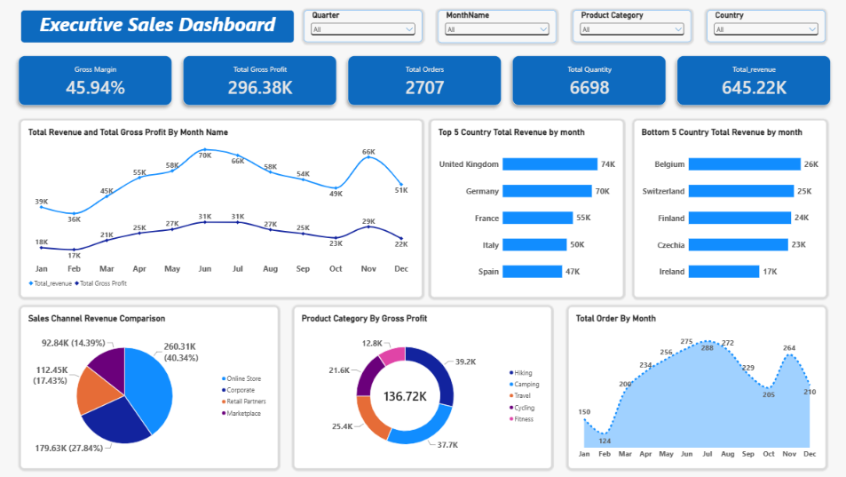

# Executive Sales Dashboard - Power BI

An interactive sales dashboard built in Microsoft Power BI to explore
revenue, gross profit, orders, quantity sold, country performance, sales
channels, and product categories.

## Dashboard Preview

## Project Overview

The dashboard brings key sales performance indicators and visual
analysis together in one report. It includes slicers to filter the
report by quarter, month, product category, and country.

## Key Performance Indicators

-   **Total Revenue:** 645.22K
-   **Total Gross Profit:** 296.38K
-   **Gross Margin:** 45.94%
-   **Total Orders:** 2,707
-   **Total Quantity:** 6,698

*Values are displayed as shown on the dashboard and may be rounded.*

## Dashboard Features

-   **KPI cards:** Revenue, gross profit, gross margin, total orders,
    and total quantity.
-   **Monthly trend analysis:** Revenue and gross profit by month.
-   **Country performance:** Top five and bottom five countries by
    revenue.
-   **Sales channel comparison:** Revenue contribution from Online
    Store, Corporate, Retail Partners, and Marketplace.
-   **Product category analysis:** Gross profit by product category.
-   **Monthly order trend:** Number of orders by month.
-   **Interactive slicers:** Quarter, Month Name, Product Category, and
    Country.

## Tools Used

-   Microsoft Power BI
-   Power Query 
-   DAX measures (include only if used in your workflow)
-   Data visualization and interactive filtering

## Dataset

The project uses the provided `Sales_Data.xlsx` dataset. The dataset
contains sales records with date, country, product category, sales
channel, revenue, gross profit, order ID, and quantity-related fields.

## Key Observations

-   Gross margin is approximately **45.94%**.
-   The dashboard compares monthly revenue and gross profit throughout
    the year.
-   The country charts highlight the top five and bottom five countries
    by revenue.
-   The sales channel chart compares revenue across four channels.
-   The product category chart compares gross profit by category.

Use the dashboard filters to explore how these metrics change across
quarters, months, product categories, and countries.

## How to View

1.  Download or clone this repository.
2.  Open the `.pbix` report in Power BI Desktop, if the Power BI report
    file is included in the repository.
3.  Use the slicers to explore the data.

## Author

**Sandip Parmar**\
Data Analysis \| Excel \| SQL \| Power BI
